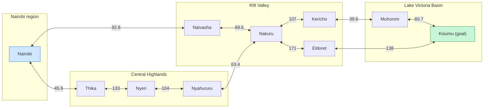
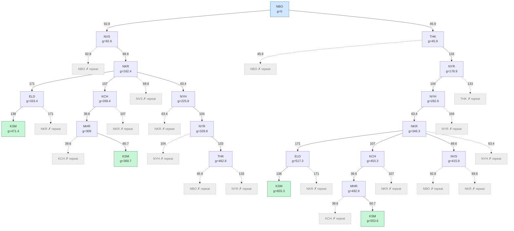

# ICS 3202: Artificial Intelligence, Practical Exercise 3: Designing a Searching Agent

| | |
|---|---|
| **Course** | ICS 3202: Artificial Intelligence (Aug–Nov 2026) |
| **Institution** | Strathmore University, School of Computing and Engineering Sciences |
| **Repository / file** | `PS-Agents` / `design.md` |
| **Group** | Group 10 (no team name) |
| **Members** | Abdullahi Osman (152386), Adan Siba (191224), Daniel Ndumbe (190374) |

> **Data note.** All road distances are driving distances (km) read from Google Maps by the group.

---

## 1. Introduction and problem definition

A self-driving trailer must travel from Nairobi to Kisumu on Kenya's highway network. This exercise specifies the agent with PEAS and classifies its task environment, models the network as a directed graph and an abstract search tree, and finds the minimum-distance route using road distance as the path cost.

Search problem formulation:

| Component | Definition |
|---|---|
| States | A town where the trailer is located |
| Initial state | Nairobi |
| Actions | Drive along a road to an adjacent town |
| Transition model | Result of driving from town *A* to town *B* is state *B* |
| Goal test | Is the current town Kisumu? |
| Path cost | Sum of road distances (km) of the segments driven |

---

## 2. Question 1: PEAS framework for the self-driving trailer

| PEAS element | Description |
|---|---|
| **Performance measure** | Safe arrival with no collisions or cargo damage; minimum total distance (and so fuel and time); compliance with traffic laws and speed limits; on-time delivery; passenger/road-user safety; smooth driving (little harsh braking); low fuel use |
| **Environment** | Kenyan highways and town roads (e.g. Nairobi–Nakuru–Kericho–Kisumu); other vehicles (matatus, lorries, motorbikes), pedestrians, livestock, road signs and markings, junctions and roundabouts, weather (rain, fog), road conditions (potholes, roadworks, steep Rift Valley escarpments), day and night, traffic police checkpoints |
| **Actuators** | Steering, accelerator, brakes (incl. trailer brakes), gear selection, indicators, headlights, horn, hazard lights, wipers, communication interface (e.g. to a dispatcher) |
| **Sensors** | Cameras, radar, LiDAR, GPS, speedometer/odometer, IMU (accelerometer, gyroscope), tyre-pressure and load sensors, fuel gauge, engine/temperature sensors, rain/light sensors, hitch-angle sensor (tractor–trailer articulation), digital road map |

### 2.1 Task-environment classification

The definitions below follow standard AI course material: [Illinois ECE 448, Lecture 3](https://courses.grainger.illinois.edu/ece448/sp2018/ece448sp2018lecture03.pdf). They are not taken from our class lecture notes.

| Property pair | Chosen | Meaning of the pair | Justification for the trailer |
|---|---|---|---|
| Observable | **Partially observable** | *Fully*: sensors give the complete relevant state at each moment. *Partially*: sensors are noisy or miss parts of the state. | The trailer cannot see around bends, behind large trucks, or other drivers' intentions; fog, rain and darkness degrade sensors; GPS can be lost. |
| Deterministic / stochastic | **Stochastic** | *Deterministic*: the next state is fully determined by the current state and action. *Stochastic*: outcomes involve uncertainty. | Braking distance varies with road wetness; other drivers behave unpredictably; a tyre may burst; a road may be closed without warning. |
| Episodic / sequential | **Sequential** | *Episodic*: each decision is independent of earlier ones. *Sequential*: current decisions affect future ones. | Choosing the Naivasha road now fixes which towns are reachable later; fuel used and time lost carry over. |
| Static / dynamic | **Dynamic** | *Static*: the environment does not change while the agent deliberates. *Dynamic*: it can change meanwhile. | Traffic, pedestrians, weather and roadworks change while the trailer is deciding and moving. |
| Discrete / continuous | **Continuous** (for driving) | *Discrete*: finite set of states/actions/percepts. *Continuous*: values range over a continuum. | Speed, steering angle, position and time are continuous. *Route planning*, after abstraction (Section 4), is **discrete** (towns and roads), so a graph search applies. |

---

## 3. Question 2: Selected towns and road connections

Ten towns were selected so that every required region is represented and several alternative routes exist.

| Region | Towns (abbreviation) |
|---|---|
| Nairobi | Nairobi (NBO) |
| Central Highlands | Thika (THK), Nyeri (NYR), Nyahururu (NYH) |
| Rift Valley | Naivasha (NVS), Nakuru (NKR), Kericho (KCH), Eldoret (ELD) |
| Lake Victoria Basin | Muhoroni (MHR), Kisumu (KSM) |

**Assumptions**

1. The town set and road links were chosen by the group and checked on Google Maps. Towns that were not directly linked, or whose road passed through another selected town, were not given an edge. For that reason there is no Nyahururu–Naivasha edge and no direct Nyahururu–Kericho edge: onward travel from Nyahururu goes through Nakuru.
2. Every road is two-way, so each road is modelled as **two directed edges** (one per direction) with the same cost. This creates cycles, which the search tree must handle.
3. Edge cost is driving distance in km (not straight-line distance).

### 3.1 Road-distance table

| # | From | To | Road distance (km) | Source |
|---|---|---|---|---|
| 1 | Nairobi | Naivasha | 92.8 | Google Maps |
| 2 | Nairobi | Thika | 45.9 | Google Maps |
| 3 | Thika | Nyeri | 133 | Google Maps |
| 4 | Nyeri | Nyahururu | 104 | Google Maps |
| 5 | Nyahururu | Nakuru | 63.4 | Google Maps |
| 6 | Naivasha | Nakuru | 69.6 | Google Maps |
| 7 | Nakuru | Kericho | 107 | Google Maps |
| 8 | Nakuru | Eldoret | 171 | Google Maps |
| 9 | Kericho | Muhoroni | 39.6 | Google Maps |
| 10 | Muhoroni | Kisumu | 60.7 | Google Maps |
| 11 | Eldoret | Kisumu | 138 | Google Maps |

Each row applies in both directions. The same data is in [`data/distances.csv`](data/distances.csv).

### 3.2 Directed graph

A double-headed arrow stands for the two directed edges A→B and B→A, each with the same cost (km).

The graph has 10 nodes and 11 roads (22 directed edges). It deliberately covers only the main alternatives, not every road in Kenya.

---

## 4. Question 2: Abstract search tree

### 4.1 Abstraction

| Included in the model | Excluded (abstracted away) |
|---|---|
| Towns as **states** | Lane position, speed, steering angle at each instant |
| Roads between towns as **transitions** (actions: "drive to town X") | Traffic, weather, roadworks, junction-by-junction details |
| Road distance as **step cost** | Fuel stops, driver/rest rules, tolls, road quality, travel time |
| Initial state Nairobi, goal Kisumu | Villages and minor roads between the chosen towns |

Abstraction removes details that do not affect the route-choice question, turning a continuous driving problem into a small discrete search problem. Low-level control (steering, braking) is left to the trailer's driving controller.

### 4.2 Tree construction

* The root is the initial state **NBO**; each child is a town reachable by one road; each edge shows the road distance and each node shows the cumulative cost **g** (km).
* Cycles: because roads are two-way, a naive tree would be infinite (NBO → NVS → NBO → …). A branch is cut (grey dashed node marked ✗ *repeat*) when it returns to a town **already on the same path**, so every branch ends.
* Green nodes are goal states (Kisumu). The tree is the complete set of loop-free paths.

The tree has four goal leaves, one for each candidate route in Section 5.

---

## 5. Question 3: Candidate routes and calculations

Path cost = sum of road distances from Section 3.1.

| Route | Towns in travel order | Segment distances (km) | Total (km) |
|---|---|---|---|
| **A** | Nairobi → Naivasha → Nakuru → Kericho → Muhoroni → Kisumu | 92.8 + 69.6 + 107 + 39.6 + 60.7 | **369.7** |
| **B** | Nairobi → Naivasha → Nakuru → Eldoret → Kisumu | 92.8 + 69.6 + 171 + 138 | **471.4** |
| **C** | Nairobi → Thika → Nyeri → Nyahururu → Nakuru → Kericho → Muhoroni → Kisumu | 45.9 + 133 + 104 + 63.4 + 107 + 39.6 + 60.7 | **553.6** |
| **D** | Nairobi → Thika → Nyeri → Nyahururu → Nakuru → Eldoret → Kisumu | 45.9 + 133 + 104 + 63.4 + 171 + 138 | **655.3** |

Check of sums: A: 92.8 + 69.6 = 162.4; + 107 = 269.4; + 39.6 = 309.0; + 60.7 = **369.7**. B: 162.4 + 171 = 333.4; + 138 = **471.4**. C: 45.9 + 133 = 178.9; + 104 = 282.9; + 63.4 = 346.3; + 107 = 453.3; + 39.6 = 492.9; + 60.7 = **553.6**. D: 346.3 + 171 = 517.3; + 138 = **655.3**.

These are the only four loop-free routes in this graph. Routes C and D are much longer because they go north to Nyeri and Nyahururu before rejoining the Rift Valley road at Nakuru. The Eldoret routes (B, D) are 101.7 km longer than the Kericho routes (A, C).

---

## 6. Question 3: Shortest-path algorithm and optimal route

**Dijkstra's algorithm.** Keep a tentative distance *d* for every town (0 for Nairobi, ∞ otherwise). Repeatedly settle the unsettled town with the smallest *d*, then *relax* its neighbours: if *d(u) + w(u,v) < d(v)*, update *d(v)*. All edge costs are non-negative, so the first time a town is settled its distance is minimal. The algorithm is implemented in [`dijkstra.py`](dijkstra.py), which reads [`data/distances.csv`](data/distances.csv).

| Step | Settled town (d) | Relaxations made |
|---|---|---|
| 1 | Nairobi (0) | Naivasha = 92.8; Thika = 45.9 |
| 2 | Thika (45.9) | Nyeri = 45.9 + 133 = 178.9 |
| 3 | Naivasha (92.8) | Nakuru = 92.8 + 69.6 = 162.4 |
| 4 | Nakuru (162.4) | Kericho = 162.4 + 107 = 269.4; Eldoret = 162.4 + 171 = 333.4; Nyahururu = 162.4 + 63.4 = 225.8 |
| 5 | Nyeri (178.9) | Nyahururu via Nyeri = 178.9 + 104 = 282.9 (no improvement over 225.8) |
| 6 | Nyahururu (225.8) | none |
| 7 | Kericho (269.4) | Muhoroni = 269.4 + 39.6 = 309.0 |
| 8 | Muhoroni (309.0) | **Kisumu = 309.0 + 60.7 = 369.7** |
| 9 | Eldoret (333.4) | Kisumu via Eldoret = 333.4 + 138 = 471.4 (no improvement) |
| 10 | Kisumu (369.7) | goal settled |

### Result

> **Shortest route in this graph: Nairobi → Naivasha → Nakuru → Kericho → Muhoroni → Kisumu, 369.7 km** (Route A). It agrees with the enumeration of all four loop-free routes in Section 5.

Limits of this conclusion:

* It holds only for the ten-town graph and the distances in Section 3.1, not for all of Kenya's roads. A road not included in the graph (for example a direct Kericho–Kisumu road) could give a shorter route.
* Distances are driving distances read from Google Maps, which can change with the route option chosen and with road works. Travel time, tolls and road condition are outside the path-cost function.

---

## 7. Conclusion

The trailer is a partially observable, stochastic, sequential, dynamic and continuous agent. Once towns are treated as states and roads as transitions, route planning becomes a discrete graph search. On the selected network, Dijkstra's algorithm gives **Nairobi → Naivasha → Nakuru → Kericho → Muhoroni → Kisumu (369.7 km)** as the shortest route.

---

## 8. References

1. University of Illinois, ECE 448 / CS 440, Lecture 3 slides on agents and rationality (PEAS and the five environment properties): <https://courses.grainger.illinois.edu/ece448/sp2018/ece448sp2018lecture03.pdf>
2. Google Maps, used for the road network and driving distances between towns: <https://www.google.com/maps>

---

## 9. Groupwork evidence

